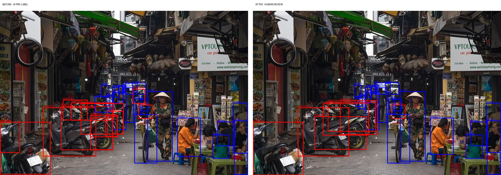

# Báo cáo Day 08 — 2A202603332 - Phạm Văn Dương

> Một file duy nhất cho cả bài (đã gộp recipe, QC và ghi chú cá nhân). Mọi con số kèm **mẫu số** và nguồn (file nào). Viết bằng lời của bạn.

## 1. Model và recipe (Part 2–3)

| Lớp | Model + cỡ | Ngưỡng | Vì sao (dẫn `run_id` trong `model_log.csv`) |
|---|---|---|---|
| person / bicycle / motorbike / car / bus / truck | YOLO26m | Sweep gợi ý `bicycle=0.2,motorbike=0.1`; các lớp còn lại dùng mặc định | YOLO26m được dùng cho các lớp có sẵn. Pilot ở confidence 0.25 và 0.5 lần lượt tạo 215 và 139 box trên 8 ảnh; chạy 36 ảnh ở confidence 0.05 tạo 1.669 box. Sweep trên 4 ảnh gold gợi ý bicycle=0.2 và motorbike=0.1; person/car không đạt recall 90% ở ngưỡng ≤0.5, bus/truck không đủ mẫu để chọn riêng. Tham chiếu `qc/threshold_sweep.md` và `r01`, `r02`, `r07`. |
| three_wheeler | YOLOE-26s, prompt theo taxonomy | Mặc định; sweep tối đa recall 88%, chưa đạt mục tiêu 90% | YOLOE được dùng bổ sung lớp ba bánh mà YOLO26 không có lớp riêng. Pilot YOLOE cho 8 box; prompt `three-wheeled vehicle` cho 11 box; lượt prompt `tuk-tuk`, `motorbike`, `car` cho 35 box. Tham chiếu `qc/threshold_sweep.md` và `r04`–`r06`, `r08`. |

- **Lệnh merge chính đã chạy**:
  ```powershell
  python scripts/merge_prelabels.py work/prelabel/yoloe_all/pre.coco.json work/prelabel/y26_all/pre.coco.json --iou 0.6 --conf 0.3 --thr "bicycle=0.2,motorbike=0.1" --split "gold,batch" --out work/prelabel/merged_review/pre.coco.json
  ```
- **Lệnh merge riêng cho batch đã chạy** :
  ```powershell
  python scripts/merge_prelabels.py work/prelabel/yoloe_all/pre.coco.json work/prelabel/y26_all/pre.coco.json --iou 0.6 --conf 0.3 --thr "bicycle=0.2,motorbike=0.1" --split "batch" --out work/prelabel/merged_review/batch_only.coco.json
  ```

- **Phiên bản SAM bạn chọn:** SAM 2.1.

  Lý do: Đã tải được trọng số `sam2.1_b.pt` và chạy thành công trên CPU. Trong thử nghiệm click, SAM tạo được mask 2.940 pixel (0,4% ảnh) với một điểm dương; khi thay đổi và bổ sung prompt, mask mở rộng lên 331.725 pixel (47,5% ảnh). Trong thử nghiệm kết hợp YOLO26 và SAM, cả 16/16 bounding box đều tạo được mask. SAM 2.1 đáp ứng yêu cầu thử nghiệm mà không cần GPU, mặc dù tốc độ xử lý còn hạn chế trên CPU.

- Lỗi nào **không sửa được bằng đổi ngưỡng** (ví dụ tuk-tuk bị gọi `car`)? Sửa thế nào?

  YOLO26 nhận diện tuk-tuk thành `car`, ví dụ `img_004.jpg` với confidence 0.37 và `img_013.jpg` với confidence 0.42. Đây là lỗi phân loại do giới hạn danh sách lớp của model, không đơn thuần là lỗi confidence. Tăng hoặc giảm ngưỡng chỉ thay đổi việc giữ hay loại bỏ box, không thể tự đổi nhãn `car` thành `three_wheeler`. Cách xử lý là sử dụng YOLOE với prompt dành riêng cho `three_wheeler`, sau đó kiểm tra và hiệu chỉnh nhãn thủ công.

- Box **điểm cao mà sai** hoặc **điểm thấp mà đúng** (ảnh nào)?

  - Điểm cao mà sai: Trong thử nghiệm YOLOE, `img_032` có box `car` confidence 0.52 ở vùng phương tiện cần kiểm tra lại; cần đối chiếu với ground truth trước khi kết luận sai nhãn.
  - Điểm thấp mà đúng: Trong thử nghiệm YOLOE lần 1, `img_032` có box `three_wheeler` confidence 0.27 nhưng vẫn phát hiện được một xe xích lô. Ở lần 2, cùng ảnh có các box tương ứng với confidence 0.70, 0.96 và 0.55.

- Giới hạn: chọn ngưỡng trên chính gold (4 ảnh) nên số đo máy trên gold là lạc quan:

  Gold manual có 4 ảnh và 65 annotation trong file; thống kê so sánh tính 51 đối tượng, không gồm `ignore_region`. Các ngưỡng được chọn và đánh giá trên chính 4 ảnh này nên kết quả có thể lạc quan. Tập nhỏ chưa đại diện đủ các tình huống giao thông, kích thước và góc nhìn khác nhau; cần kiểm tra ngưỡng trên dữ liệu độc lập trước khi áp dụng rộng rãi.

## 2. AI error profile (từ qc/review_stats.md)

| Trạng thái | Số | Tỉ lệ | Mẫu số |
|---|---:|---:|---:|
| accepted | 423 | 69,1% | 612 box máy |
| edited | 76 | 12,4% | 612 box máy |
| deleted | 113 | 18,5% | 612 box máy |
| added | 44 | 8,1% | 543 đối tượng sau duyệt |

- **Lớp máy hoạt động kém nhất:** motorbike.
Nguyên nhân: mô hình tạo nhiều bounding box chồng lấn trên cùng một xe máy, đặc biệt trong cảnh đông phương tiện. Ngoài ra, một số box có vị trí, kích thước chưa chính xác và nhầm lẫn với các lớp khác


**Hình minh họa: So sánh kết quả trước và sau khi Human Review trên img_006.jpg**




*Hình: Kết quả AI Pre-label (bên trái) và kết quả sau Human Review (bên phải). Người duyệt đã loại bỏ các bounding box motorbike chồng lấn hoặc không phù hợp, trong đó có 8/13 box motorbike ban đầu bị xóa.*

- **So với Gold:** Precision = 43/83 = 51,8%; Recall = 43/51 = 84,3%. Mẫu gồm 51 đối tượng Gold được tính (không gồm `ignore_region`) trên 4 ảnh.

## 3. Thiên kiến tự động hóa và ảnh bẫy

- Bắt được 10/12 = 83,3%; lọt 2 bẫy `loose`: `img_029.jpg`, `img_026.jpg` (nguồn: `qc/review_stats.md`). Nguyên nhân và bước checklist đã bỏ cần người duyệt tự xác nhận.
- Nguyên nhân người duyệt tự nhận định: chú ý đến đối tượng/nhãn nhưng chưa kiểm tra kỹ độ khít box. Cần kiểm tra đủ bốn cạnh, loại phần nền thừa. Dù bắt bẫy đạt ngưỡng, 2/3 bẫy `loose` vẫn lọt.
- Quy tắc giảm thiên kiến đã áp dụng/đề xuất: quan sát toàn ảnh trước nhãn máy; kiểm tra từng box độc lập về vật thể, vị trí và lớp; kiểm tra cả bốn cạnh box.

## 4. Máy có đáng dùng không?

- Thời gian (từ `time_log.csv`): gán tay 30/4 = 7,5 phút/ảnh; duyệt có pre-label 70/24 ≈ 2,9 phút/ảnh. Gold được gán trước nên người duyệt có thể đã quen với một số cảnh; kết quả thời gian không phải so sánh độc lập hoàn toàn.
- Kết luận: AI hữu ích tương đối cho `person` và `car`; `motorbike` cần chỉnh sửa; `three_wheeler` cần kiểm duyệt kỹ; `bicycle`, `bus`, `truck` chưa đủ bằng chứng để kết luận. Số liệu đối chiếu gồm 69,1% accepted trong 612 box máy, 8,1% added trên 543 đối tượng sau duyệt, và precision/recall trên gold 43/83 và 43/51.
- **Ba quy tắc giảm thiên kiến của bạn** (mỗi quy tắc kiểm tra được bằng số hoặc việc làm):
  1. Quan sát toàn bộ ảnh trước khi xem nhãn AI để tránh bỏ sót đối tượng.
  2. Kiểm tra độc lập từng box về đối tượng, vị trí và lớp.
  3. Kiểm tra độ khít cả bốn cạnh bounding box; không chấp nhận box chứa quá nhiều nền.


## 5. Mask SAM cho 3 vật (Part 5)

| Ảnh | SAM (phiên bản) | Số click | Mask gồm người lái / hàng hóa? | Lỗi quan sát | File kết quả |
|---|---|---|---|---|---|
| `img_013` thử nghiệm a | SAM 2.1 | 1 (1 dương) | Có người lái | Mask bao gồm cả người lái và phương tiện | `submission/masks/img_013_sam21_a.jpg` |
| `img_013` thử nghiệm b | SAM 2.1 | 2 (2 dương) | Có người lái | Mask vẫn chưa tách được người lái khỏi phương tiện | `submission/masks/img_013_sam21_b.jpg` |
| `img_013` thử nghiệm c | SAM 2.1 | 3 (2 dương, 1 âm) | Có người lái | Bổ sung điểm âm trên người lái nhưng mask vẫn còn vùng phân đoạn chưa chính xác | `submission/masks/img_013_sam21_c.jpg` |
| `img_010` xích lô | SAM 2.1 | 4 (3 dương, 1 âm) + box | có người lái | Mask chưa tách chính xác phần xe và người ngồi trên xe. Vùng mask còn bao gồm người, ghế, mui xe và một số vùng nền; đồng thời bỏ sót một số bộ phận của phương tiện. | `submission/masks/img_010_cyclo_sam21.jpg` |
| `img_031` xe đạp chở hàng | SAM 2.1 | 4 (2 dương, 2 âm) + box | Có hàng hóa, có người lái ở bên cạnh | Mask nhận diện chưa chính xác ranh giới xe đạp, còn lẫn một phần nền. Một số bộ phận của xe cũng chưa được phân đoạn đầy đủ. | `submission/masks/img_031_bicycle_sam21.jpg` |

Ba lần thử đầu là các cấu hình click khác nhau trên cùng tuk-tuk ở `img_013`. Hai mask bổ sung được tạo bằng SAM 2.1 trên xích lô ở `img_010` và xe đạp chở hàng ở `img_031`; như vậy hiện có ví dụ cho ba vật khác nhau.

### Đối chiếu guideline mục 4.2

Quy tắc xác định ranh giới phương tiện giúp định hướng phạm vi mask. Tuy nhiên, trường hợp người lái ngồi bên trong hoặc chồng lấn với phương tiện vẫn gây khó khăn cho SAM. Cần làm rõ hướng dẫn về việc loại trừ người lái khỏi mask phương tiện và xử lý các vùng bị che khuất.

### Interactor SAM trong CVAT: chưa thử nghiệm

## 6. Calibration (Part 6)

- Có 3 quyết định trong `calibration_decisions.csv`. CAL-02 chốt cách xử lý mask người lái trong xe ba bánh có mui: tách người khỏi mask phương tiện và chỉnh thủ công khi SAM gộp hai đối tượng.
- Quy tắc được bổ sung vào `guideline_v1.1_calibrated.md`: kiểm tra lớp và biên box của xe ba bánh; không giữ phần người trong mask phương tiện; kiểm tra đủ bốn cạnh để tránh box lỏng.
- Nguyên nhân gốc khác nhau theo ca: lỗi phân lớp là lỗi model (CAL-01); phạm vi mask người/xe cần làm rõ (CAL-02); bẫy loose bị lọt do chưa kiểm tra đủ độ khít box (CAL-03).

## 7. QC và quyết định (Part 6)

- **Mẫu:** 5 ảnh (0 ảnh `can_review` + 5 ảnh ngẫu nhiên, seed 42); người kiểm: Duong (hạn chế: người kiểm đồng thời là người duyệt).
- **Lỗi theo đối tượng:** 0/100 = 0% · theo ảnh: 0/5 = 0% (ngưỡng Release ≤ 2%).
- **Top lỗi:** Không ghi nhận lỗi nào trong mẫu QC vòng 2.
- **Giới hạn mẫu nhỏ:** Cận trên 95% (Wilson) của tỷ lệ ảnh lỗi thực tế là 43%. Mẫu 5 ảnh chưa đủ để chứng minh tỷ lệ lỗi thực tế ≤ 2%.
- **Script kiểm được:** Tên file, lớp theo taxonomy, box nằm trong ảnh, số lượng ảnh và các chỉ số thống kê QC. **Không kiểm được:** Box có ôm sát vật thể hay không, lớp có đúng với thực tế không, các vật thể mà cả người và máy cùng bỏ sót, và việc người duyệt có thực sự tuân thủ checklist hay không.

**Quyết định: Release**, ngày 2026-11-18.

**Lý do:** QC vòng 2 không phát hiện lỗi (0/5 ảnh = 0%), đạt ngưỡng Release ≤ 2%. Lỗi thừa tại `img_031.jpg` ở vòng 1 đã được sửa và cập nhật vào bản Release. Không ghi nhận lỗi trong mẫu kiểm tra vòng 2. Tuy nhiên, kết quả còn hạn chế do kích thước mẫu nhỏ.

## 8. Ghi chú cá nhân

- **Dùng AI để làm bài**: ChatGPT hỗ trợ hướng dẫn, giải thích, diễn đạt lại ý
- Gold: 4 ảnh được gán thủ công từ đầu làm ground truth; không dùng pre-label hay AI để tạo gold.
- Máy / GPU / CVAT: Windows 11, Intel Iris Xe, NVIDIA GeForce MX550 2 GB; PyTorch trong `.venv` là CPU-only, các lần chạy log dùng CPU; CVAT Docker v2.81.0.
- Dùng cache `data/cache/`: không; tự chạy độc lập.
- Lỗi / bug script đã gặp: chưa ghi nhận.
- Một điều làm khác lần sau: quét toàn ảnh trước nhãn máy, kiểm tra vật thể/nhãn/vị trí từng box và độ khít cả bốn cạnh.
